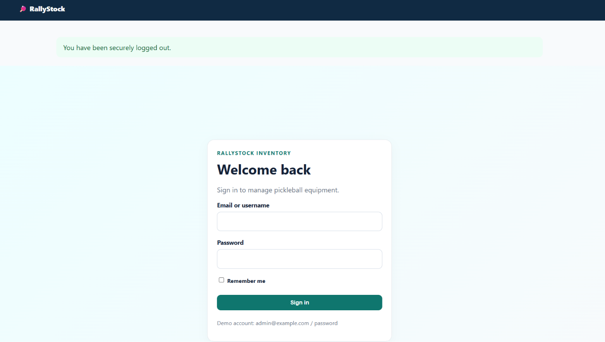
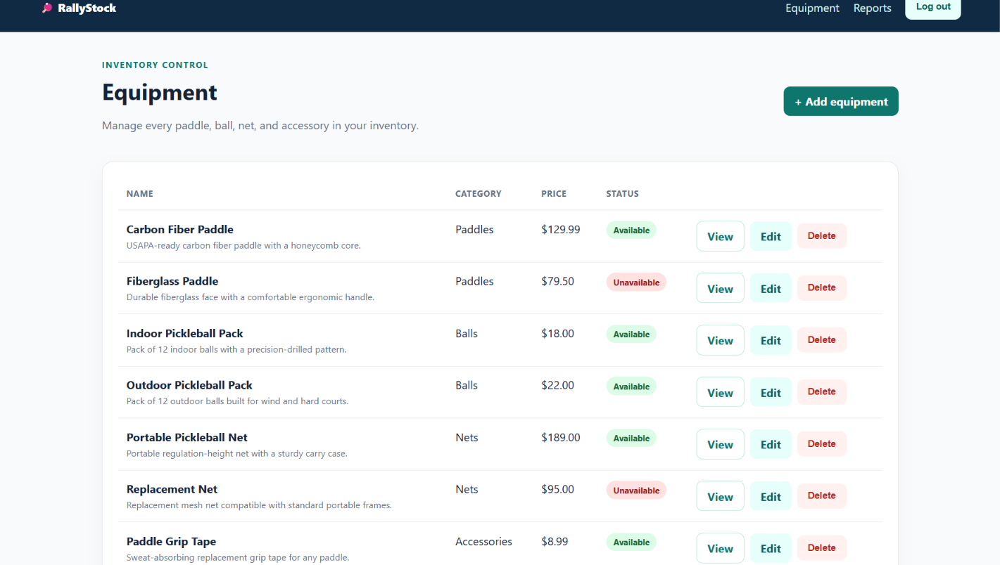
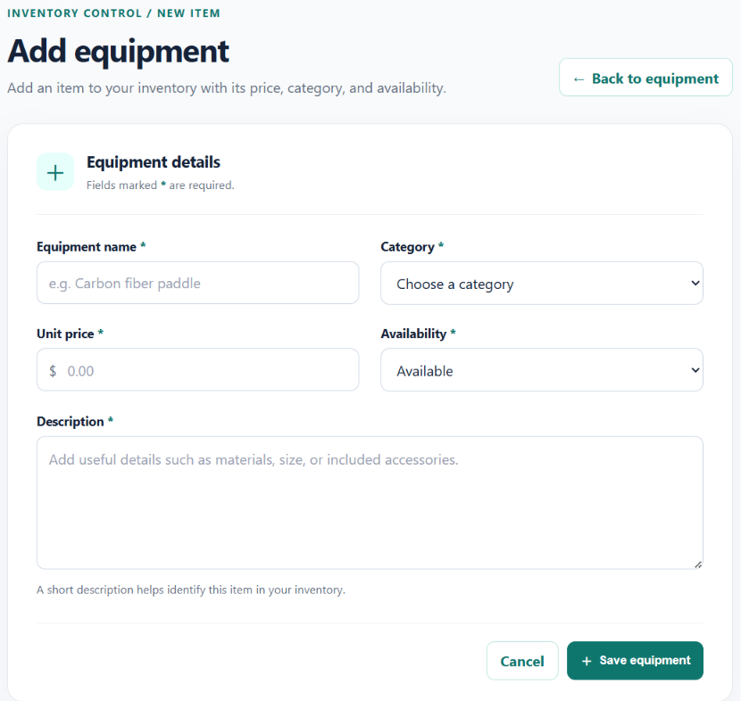
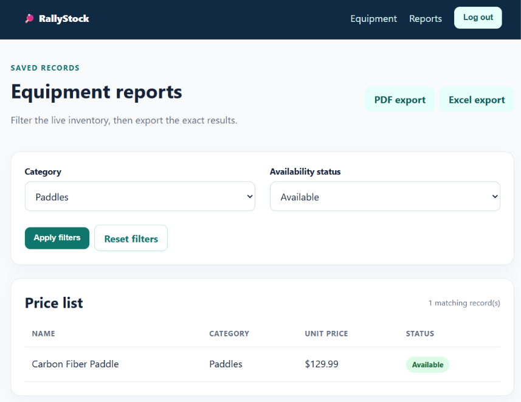

# RallyStock

RallyStock is a small inventory management application for pickleball equipment. Users can add, edit, view, and remove inventory items, filter reports by category and availability, and export reports.

## Screenshots

### Sign in



### Equipment inventory



### Add equipment



### Equipment report



## Requirements

- PHP 8.3 or later with the SQLite extension enabled
- Composer

## Local setup

1. Clone the repository and install PHP dependencies:

   ```sh
   git clone https://github.com/JstXia/calibo_departpractact2.git
   cd calibo_departpractact2
   composer install
   ```

2. Create the environment file and application key:

   ```sh
   cp .env.example .env
   php artisan key:generate
   ```

   On Windows PowerShell, use `Copy-Item .env.example .env` instead of `cp` if needed.

3. Configure the database in `.env`. The default configuration uses SQLite:

   ```dotenv
   DB_CONNECTION=sqlite
   ```

   Create the SQLite file if it does not exist, then run migrations and seed the demo account and sample inventory:

   ```sh
   # macOS / Linux
   touch database/database.sqlite

   # Windows PowerShell
   New-Item -ItemType File -Force database/database.sqlite

   php artisan migrate --seed
   ```

   To use MySQL instead, set `DB_CONNECTION=mysql` and configure `DB_HOST`, `DB_PORT`, `DB_DATABASE`, `DB_USERNAME`, and `DB_PASSWORD` in `.env` before migrating.

4. Start the local application server:

   ```sh
   php artisan serve --host=127.0.0.1 --port=8000
   ```

   Open the application at **http://127.0.0.1:8000**.

## Demo administrator account

The database seeder creates this local demo account:

- **Email:** `admin@example.com`
- **Password:** `password`

Sign in at http://127.0.0.1:8000/login. This seeded password is for local demonstration only; change it before deploying the application to a shared or production environment.

## Main pages

- Equipment inventory: http://127.0.0.1:8000/equipment
- Add equipment: http://127.0.0.1:8000/equipment/create
- Reports and exports: http://127.0.0.1:8000/reports

## Tests

Run the application test suite with:

```sh
php artisan test
```
